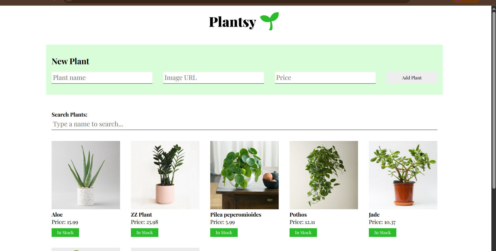

# Plantshop

A React app for browsing and managing a plant shop's inventory, connected to a json-server backend.



## Features
- View all plants fetched from the backend on page load
- Add a new plant through a form (saved to the backend with a POST request)
- Mark a plant as "Out of Stock" (not persisted, resets on refresh)
- Search plants by name with a live filter

## Installation
```
git clone https://github.com/brovincemangwana/react-hooks-plantshop-cr-vite.git
cd react-hooks-plantshop-cr-vite
npm install
```

## Usage
Run the backend and the frontend in separate terminals:
```
npm run server
npm run dev
```
The backend runs on http://localhost:6001 and the app opens at the URL Vite prints (usually http://localhost:5173).

## Testing
```
npm run test
```

## Built With
- React
- Vite
- json-server
- Vitest

## Author
Brovince Mangwana